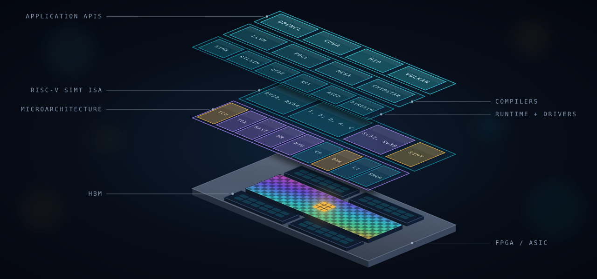

# GhOST on Vortex SIMX (CSE 254A Project)

This repository extends the [Vortex GPGPU](https://github.com/vortexgpgpu/vortex) C++ cycle-level simulator (**SIMX**) to explore **GhOST** (GPU out-of-order scheduling) at the per-warp issue boundary.

> **Working Reference & Architecture Notes:** See [`z_ghost_project_notes/simx_foundation/GHOST_SIMX_GUIDE.md`](z_ghost_project_notes/simx_foundation/GHOST_SIMX_GUIDE.md) for the current pipeline mapping, stage contracts, limits, and test/trace commands. The proposal in [`docs/proposals/ghost_simx_foundation_proposal.md`](docs/proposals/ghost_simx_foundation_proposal.md) records the original foundation design.

---

## Current Project Status

- **Stateful SIMX-only prototype:** `SIMX_GHOST_ENABLE` inserts GhOST DC, IsB, and Scheduler/ITab between decoded I-buffer entries and existing issue arbitration.
- **Dependency and ordering logic:** Tracks intra-IsB register dependencies and scoreboard hazards; permits load/load reordering, preserves conflicting memory order through completion, and holds branches/synchronization/unsupported classes conservatively.
- **Configurable storage:** Defaults to 8 IsB entries and 2 ITab candidates per warp; override with `SIMX_GHOST_ISB_SIZE` and `SIMX_GHOST_ITAB_SIZE`.
- **Observable issue order:** At `--debug=3`, candidate and accepted issue events can be exported to CSV with `ci/trace_order.py`. The `ghost` regression verifies a load-dependent result and exhibits legal independent-instruction overtaking.
- **Scope and maturity:** SIMX only; this is a prototype, not a claim of full paper-equivalent behavior. See the working guide for limitations and remaining validation.

---

## Key Added & Modified Files

| Path | Description |
| :--- | :--- |
| `sim/simx/ghost.h` | Defines the GhOST instruction/dependency records, dependence checker, per-warp IsB, scheduler/ITab, and pipeline coordinator. |
| `sim/simx/core.cpp` | Connects GhOST candidates to the existing sequencer, scoreboard, structural checks, and issue arbiter; logs candidate and accepted issue events. |
| `sim/simx/sequencer.cpp` | Keeps OoO-selected simple traces independent; continues caching sequencer-generated macro-op micro-ops. |
| `tests/regression/ghost/` | SIMX regression covering load-RAW, register-WAR/WAW, independent-instruction overtaking, and result correctness. |
| `tests/regression/Makefile` | Registers the `ghost` target for SIMX regression runs. |
| `ci/trace_order.py` | Parses SIMX `--debug=3` logs into CSV rows (`cycle,event,core,cid,wid,pc,uuid,opcode`). |
| `z_ghost_project_notes/` | Design guide, SIMX pipeline mapping, and checkpoint notes. |

---

## Quick Validation Instructions (SIMX)

Assuming the Vortex toolchain is installed (e.g., at `$HOME/tools`), configure an out-of-tree `XLEN=32` build from the repository root:

```bash
mkdir -p build && cd build
../configure --xlen=32 --tooldir="$HOME/tools"
CONFIGS="-DSIMX_GHOST_ENABLE" ./ci/blackbox.sh --driver=simx --app=ghost
CONFIGS="-DSIMX_GHOST_ENABLE" ./ci/blackbox.sh \
  --driver=simx --app=ghost --debug=3 --log=ghost.log
python3 ci/trace_order.py ghost.log > ghost_issue_order.csv
grep -E ',(LW|ADDI|ADD)$' ghost_issue_order.csv
```

Default capacities are 8 IsB entries and 2 ITab candidates per warp. To
override them, pass `-DSIMX_GHOST_ISB_SIZE=<n>` and
`-DSIMX_GHOST_ITAB_SIZE=<n>` in `CONFIGS`; ITab capacity must not exceed IsB
capacity. The full guide linked above covers baseline comparison, expected
trace order, and regression commands.


-----------------------------------------------------------------------


<p align="center">
  
</p>

# Vortex GPGPU

Vortex is a full-stack open-source RISC-V GPGPU. Vortex supports multiple **backend drivers**, including our C++ simulator (simx), an RTL simulator, and physical Xilinx and Altera FPGAs-- all controlled by a single driver script. The chosen driver determines the corresponding code invoked to run Vortex. Generally, developers will prototype their intended design in simx, before completing going forward with an RTL implementation. Alternatively, you can get up and running by selecting a driver of your choice and running a demo program.

## Website
Vortex news can be found on its [website](https://vortexgpgpu.github.io/index.html)

## Citation
```
@inproceedings{10.1145/3466752.3480128,
	author = {Tine, Blaise and Yalamarthy, Krishna Praveen and Elsabbagh, Fares and Hyesoon, Kim},
	title = {Vortex: Extending the RISC-V ISA for GPGPU and 3D-Graphics},
	year = {2021},
	isbn = {9781450385572},
	publisher = {Association for Computing Machinery},
	address = {New York, NY, USA},
	url = {https://doi.org/10.1145/3466752.3480128},
	doi = {10.1145/3466752.3480128},
	abstract = {The importance of open-source hardware and software has been increasing. However, despite GPUs being one of the more popular accelerators across various applications, there is very little open-source GPU infrastructure in the public domain. We argue that one of the reasons for the lack of open-source infrastructure for GPUs is rooted in the complexity of their ISA and software stacks. In this work, we first propose an ISA extension to RISC-V that supports GPGPUs and graphics. The main goal of the ISA extension proposal is to minimize the ISA changes so that the corresponding changes to the open-source ecosystem are also minimal, which makes for a sustainable development ecosystem. To demonstrate the feasibility of the minimally extended RISC-V ISA, we implemented the complete software and hardware stacks of Vortex on FPGA. Vortex is a PCIe-based soft GPU that supports OpenCL and OpenGL. Vortex can be used in a variety of applications, including machine learning, graph analytics, and graphics rendering. Vortex can scale up to 32 cores on an Altera Stratix 10 FPGA, delivering a peak performance of 25.6 GFlops at 200 Mhz.},
	booktitle = {MICRO-54: 54th Annual IEEE/ACM International Symposium on Microarchitecture},
	pages = {754–766},
	numpages = {13},
	keywords = {reconfigurable computing, memory systems., computer graphics},
	location = {Virtual Event, Greece},
	series = {MICRO '21}
}
```

## Specifications

- Support RISC-V RV32IMAFC and RV64IMAFDC

- Microarchitecture:
    - configurable number of cores, warps, and threads.
    - configurable number of ALU, FPU, LSU, and SFU units per core.
    - graphics fixed-function pipeline (rasterizer, texture units, output mergers).
    - hardware ray-tracing unit (BVH traversal, ray-box and ray-triangle intersection).
    - tensor cores with WGMMA and 2:4 structured sparsity support.
    - hardware-accelerated command processor and kernel management unit.
    - configurable pipeline issue width.
    - optional local memory, L1, L2, and L3 caches.
- Software:
    - OpenCL 1.2
    - Vulkan
    - HIP
- Supported FPGAs:
    - Altera Arria 10
    - Altera Stratix 10
    - Xilinx Alveo U50, U55C, U250, U280
    - Xilinx Alveo V80 (Versal, via the SLASH platform — see [setup guide](docs/xilinx_slash_setup.md))
    - Xilinx Versal VCK5000

## Directory structure

- `doc`: [Documentation](docs/index.md).
- `hw`: Hardware sources.
- `sw`: Software sources (kernel, runtime, and drivers).
- `sim`: Simulators repository.
- `tests`: Tests repository.
- `ci`: Continuous integration scripts.
- `miscs`: Miscellaneous resources.
- `VX_config.toml` / `VX_types.toml`: Hardware configuration system.

## Quick Start
If you are interested in a stable release of Vortex, you can download the latest release [here](https://github.com/vortexgpgpu/vortex/releases/latest). Otherwise, you can pull the most recent, but (potentially) unstable version as shown below. The following steps demonstrate how to build and run Vortex with the default driver: SimX. If you are interested in a different backend, look [here](docs/simulation.md).

### Supported OS Platforms
- Ubuntu 22.04
- Centos 7
### Toolchain Dependencies
The following dependencies will be fetched prebuilt by `toolchain_install.sh`.
- [POCL](http://portablecl.org/)
- [LLVM](https://llvm.org/)
- [RISCV-GNU-TOOLCHAIN](https://github.com/riscv-collab/riscv-gnu-toolchain)
- [Verilator](https://www.veripool.org/verilator)
- [cvfpu](https://github.com/openhwgroup/cvfpu.git)
- [SoftFloat](https://github.com/ucb-bar/berkeley-softfloat-3.git)
- [Ramulator](https://github.com/CMU-SAFARI/ramulator.git)
- [Yosys](https://github.com/YosysHQ/yosys)
- [Sv2v](https://github.com/zachjs/sv2v)
- [Mesa](https://www.mesa3d.org/)
- [chipStar](https://github.com/CHIP-Star/chipStar)
### Install Vortex codebase
```sh
	git clone --depth=1 --recursive https://github.com/vortexgpgpu/vortex.git
	cd vortex
```
### Install system dependencies
```sh
# ensure dependent libraries are present
sudo ./ci/install_dependencies.sh
```
### Configure your build folder
```sh
    mkdir build
    cd build
    # for 32bit
    ../configure --xlen=32 --tooldir=$HOME/tools
    # for 64bit
    ../configure --xlen=64 --tooldir=$HOME/tools
```
### Install prebuilt toolchain
```sh
   ./ci/toolchain_install.sh
```

### Building and installing Vortex
```sh
make -s
make install
export VORTEX_PATH=$(pwd)/install
export PKG_CONFIG_PATH=$VORTEX_PATH/lib/pkgconfig:$PKG_CONFIG_PATH
```
`make install` lays out a sysroot under `$VORTEX_PATH` containing the
public headers, libraries, and `vortex-runtime.pc` / `vortex-kernel.pc`
pkg-config files. Downstream tools (mesa-vortex, pocl-vortex,
chipstar) integrate with Vortex exclusively through `$VORTEX_PATH` and
pkg-config — the same shape as the CUDA, ROCm and oneAPI SDKs. The
source tree (`$VORTEX_HOME`) and build tree (`$VORTEX_BUILD_DIR`) are
internal to Vortex and not exposed to consumers. Override the install
root with `../configure --prefix=<path>` or `--installdir=<path>` (default `<build>/install`).

### Quick demo running vecadd OpenCL kernel on 2 cores
```sh
./ci/blackbox.sh --cores=2 --app=vecadd
```

### Compiler Toolchain (VOLT)

Vortex's compiler toolchain is **[VOLT](https://github.com/vortexgpgpu/Volt)** (Vortex-Optimized Lightweight Toolchain), an LLVM-based SIMT compiler for the Vortex GPU. To build the toolchain locally instead of using the prebuilt one, follow the instructions in the [VOLT repo](https://github.com/vortexgpgpu/Volt). Its design is described in the [VOLT paper (CC '26)](https://dl.acm.org/doi/10.1145/3771775.3786275).

### Common Developer Tips
- Building Vortex 64-bit requires setting --xlen=64 configure option.
```sh
../configure --xlen=64 --tooldir=$HOME/tools
```
- No shell environment setup is required. `../configure` bakes the full
  toolchain layout (paths, XCONFIGS, every tool binary) into the build
  dir's `config.mk` and domain `common.mk` files. Make recipes invoke
  tools by absolute path (`$(VERILATOR_PATH)/bin/verilator` etc.), so
  multiple Vortex trees on the same machine can coexist without any
  `~/.bashrc` sourcing.
- Making changes to Makefiles in your source tree, editing `VX_config.toml` (or any `*.toml`), or adding new folders will require executing the "configure" script again without any options to get changes propagated to your build folder.
```sh
../configure
```
- Always make sure your build is up to date before running any test or app: re-run `../configure` from your build folder first. `configure` regenerates `<build>/sw/VX_config.h` and `<build>/hw/*.vh` from `VX_config.toml` (only when the toml is newer). The simulator and RTL `#include` this generated header, so a stale header makes them compile against old config values and silently diverge from the toml. `VX_config.toml` is the single source of truth — never paper over a divergence by hardcoding `-DVX_CFG_*` flags in a Makefile; re-`configure` instead.
- To debug the GPU, the simulation can generate a runtime trace for analysis. See /docs/debugging.md for more information.
```sh
./ci/blackbox.sh --app=demo --debug=3
```
- Running the CI suite locally: the test catalog lives in `ci/testcases/` and runs
  through pytest via the `regression.sh` wrapper (from your build folder). See
  [docs/continuous_integration.md](docs/continuous_integration.md) for details.
```sh
./ci/regression.sh --all               # full catalog
./ci/regression.sh --test regression   # one category
```
- For additional information, check out the [documentation](docs/index.md)

